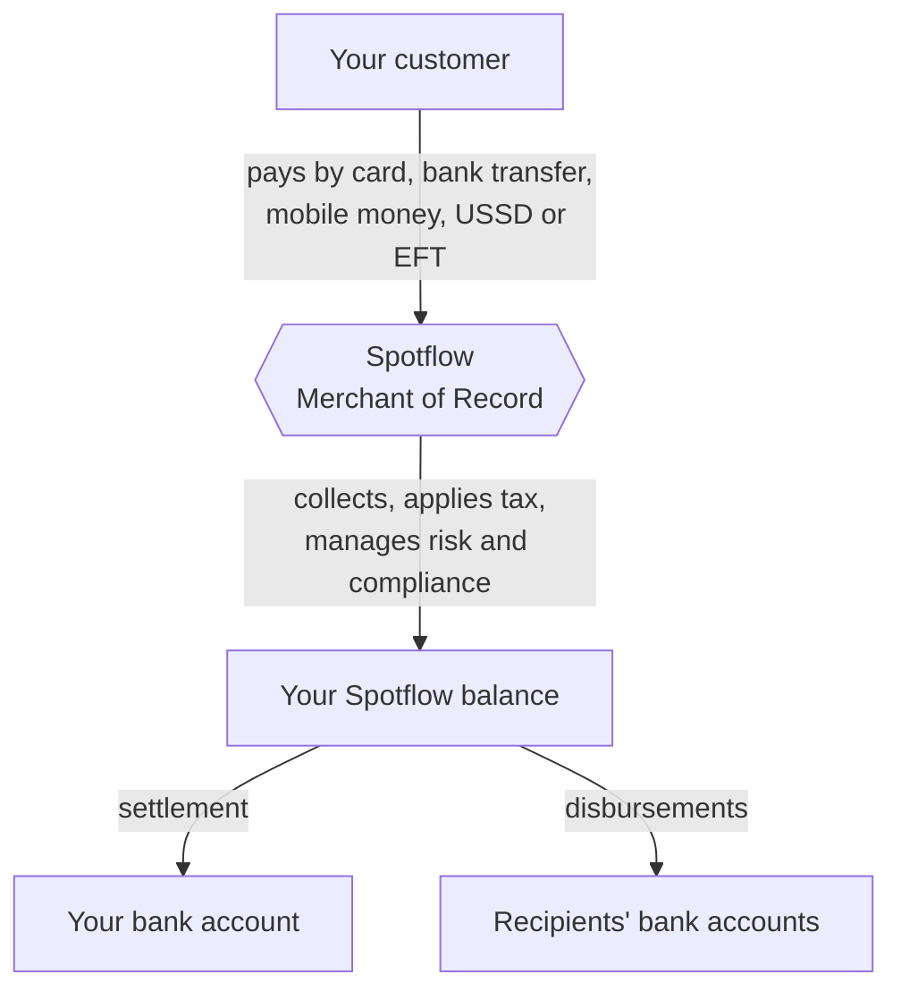

Spotflow is your **Merchant of Record (MoR)**. When your customer pays, Spotflow is the legal seller: we collect the payment through local payment methods, handle local tax and compliance, and send you the net revenue. You don't need a local entity in every country you sell in.

## The money flow

<Steps>
  <Step title="Your customer pays">
    You start a payment through the API, a payment link, our SDKs or libraries. The customer pays with a method that's local to them, such as mobile money, a bank transfer or a card. Supported methods are activated automatically once your account is verified. See [Payment methods](/features/payment-methods).
  </Step>
  <Step title="Spotflow collects and handles compliance">
    As the legal seller, Spotflow handles local tax and regulatory requirements, with built-in fraud and chargeback protection. Taxes you configure are collected on each payment. See [Tax configuration](/features/tax-collections).
  </Step>
  <Step title="Funds land in your balance">
    The payment moves from `PENDING` to `SUCCESSFUL`, and the funds are credited to your Spotflow balance. See [Payment lifecycle](/developer-resources/payment-states).
  </Step>
  <Step title="You get paid out">
    Revenue is [settled](/features/settlement) to your bank account on your [payout cycle](/features/payout-structure), or you can send money onward with [disbursements](/features/single-and-bulk-disbursements).
  </Step>
</Steps>

## Merchant of Record vs payment gateway

| | Spotflow (MoR) | Traditional payment gateway |
|---|---|---|
| Legal seller | Spotflow | Your company |
| Tax and compliance | Handled by Spotflow | Your responsibility in every country |
| Payment methods | Local methods such as mobile money and EFT across 26+ African countries | Mostly global card networks |
| Risk management | Built-in fraud and chargeback protection | You set up your own tools |
| Payouts | Aggregated payouts to your preferred account | Direct from the gateway, with complex bank setup |

Read the full comparison in [MoR vs PG](/features/mor-vs-pg).

## Building blocks

<CardGroup cols={2}>
  <Card title="Payment collections" icon="credit-card" href="/features/payment-collections">
    One-time payments through a hosted checkout, the API, SDKs or payment links.
  </Card>
  <Card title="Subscriptions" icon="repeat" href="/features/subscription-payment-collections">
    Recurring billing with plans, trials and automated renewals.
  </Card>
  <Card title="Virtual accounts" icon="building-columns" href="/features/static-accounts">
    Static accounts that hold funds, and dynamic accounts that route payments.
  </Card>
  <Card title="Disbursements" icon="paper-plane" href="/features/single-and-bulk-disbursements">
    Single and bulk payouts to bank accounts.
  </Card>
  <Card title="Tax configuration" icon="percent" href="/features/tax-collections">
    Collect VAT or a flat levy by region.
  </Card>
  <Card title="Webhooks" icon="bell" href="/developer-resources/webhooks/overview">
    Real-time notifications when payments, subscriptions and accounts change.
  </Card>
</CardGroup>

## Two ways to work

| | Dashboard | API |
|---|---|---|
| Who it's for | Teams operating day to day, or anyone who wants to start without code | Platforms integrating Spotflow into their product |
| Where | [app.spotflow.co](https://app.spotflow.co/) | `https://api.spotflow.co/api/v1` |
| Start here | [Payment links in under 5 minutes](/developer-resources/integration-guide) | [Quickstart](/quickstart) |
